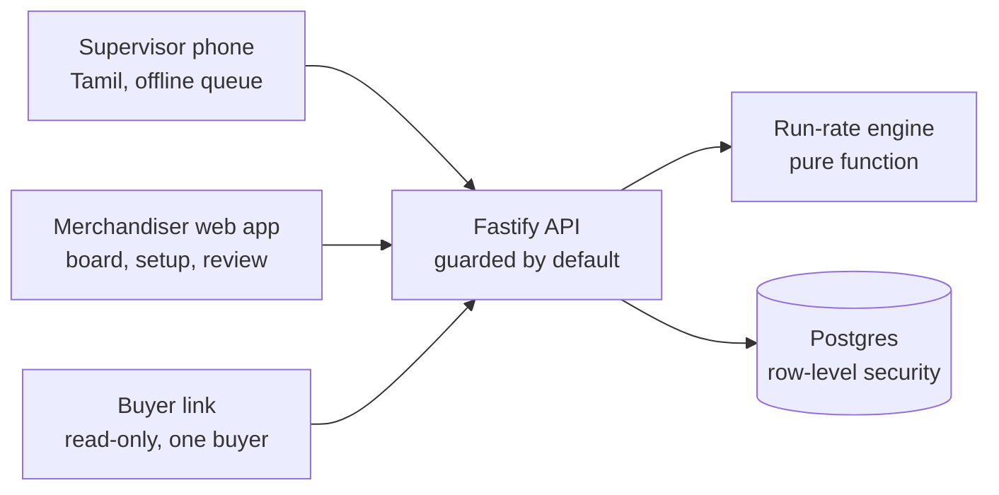

# IsoCode Knitwear: order tracking

[](https://github.com/xeyynon/IsoCode_Knitwear/actions/workflows/ci.yml)
[](https://github.com/xeyynon/IsoCode_Knitwear/actions/workflows/release.yml)

Order tracking for a knitwear exporter. Supervisors on the floor send a daily count from a phone, in Tamil, even without a signal. A server works out, for every order, whether it will ship on time and shows the reasoning. Merchandisers see the orders that need attention first; buyers get a read-only view of only their own orders.

> **Status: early build.** The calculation engine, database, API, the merchandiser's order board, order setup and order detail, and the supervisor's offline daily update work and are tested. The review gate and the buyer's read-only view work and are tested; photos and notes are not built yet. See [Status](#status) and [Roadmap](#roadmap).

## Contents
[Why](#why) · [Status](#status) · [How the colours are decided](#how-the-colours-are-decided) · [Architecture](#architecture) · [Repository layout](#repository-layout) · [Getting started](#getting-started) · [Configuration](#configuration) · [API](#api) · [Security model](#security-model) · [Testing](#testing) · [Development workflow](#development-workflow) · [CI and releases](#ci-and-releases) · [Roadmap](#roadmap)

## Why
Orders slip because progress on the floor reaches the merchandiser late, by phone or chat, and the delay is noticed when it is too late to recover. This project replaces chasing with a live board:

- **Floor to board in one tap.** A supervisor enters today's pieces for a stage. The server recomputes the order's status.
- **A colour you can explain.** Every row shows the sum behind its colour: *need 467 a day, making 350 a day, 700 pieces short by 11 Nov.*
- **Honest by design.** An order with no updates is grey, never green. A rate based on little data is labelled an estimate. Nothing reaches a buyer until a merchandiser confirms it.

## Status

| Area | State |
| --- | --- |
| Run-rate engine (status, projected finish, working-day calendars, TNA back-scheduling) | Built, 40 tests |
| Database schema with row-level security | Built, tested |
| HTTP API: sign-in with lockout, board, daily updates (single and batch), order creation, ex-factory change with logged reason, status check | Built, tested |
| Web app: sign-in, order board, public status page | Built (`build-1000`) |
| Supervisor app: "My orders today", the daily update, an offline queue that survives restarts, "3 waiting" status, and the app opening with no signal | Built (`build-1001`), 14 browser checks |
| Order setup (with a schedule preview before creating) and order detail (planned versus projected dates, the working behind each colour, date-change history, change ex-factory with a reason) | Built (`build-1002`) |
| Photos and notes on an update | **Not built** |
| Review queue (confirm, reword or hide a warning before a buyer can see it), buyer links (create, cancel, expire) and the buyer's read-only page, with automated cross-buyer leak tests | Built (`build-1003`) |
| Voice and text notes | **Not built** |

**Not yet verified:** nothing has run against a production Postgres server or on real phones (the offline checks ran in a desktop browser at phone size), and the Tamil wording has not been checked with floor supervisors.

## How the colours are decided
For each stage, in order, the engine takes the pieces still to make, the working days left (in that stage's own unit calendar), and the recent rate (the average of the last five days with an update).

| Colour | Rule |
| --- | --- |
| **Red** (late risk) | Making under 90% of the rate needed; the milestone has passed with pieces left; no output; or this or a later stage is projected past ex-factory |
| **Amber** (at risk) | Making 90 to 100% of the rate needed, or under 2 working days of buffer before ex-factory |
| **Green** (on track) | Making at least the rate needed, with a 2-day buffer, and a recent update |
| **Grey** (no update) | No output yet, or a good rate that has gone quiet. Never shown as green |

The order's colour is its worst stage. Thresholds live in a settings table. Every colour is also shown with an icon and a word, because red, amber and green are almost the same lightness and cannot carry meaning alone.

*A deliberate departure from the first written spec:* slipping past a stage milestone is not red by itself, because otherwise the amber band could never be reached. Red needs the order to be projected past ex-factory. This is recorded as a decision and should be confirmed with the business.

## Architecture


- **Phones never compute status.** They send dated events; the server recomputes after each one.
- **The engine is a pure function** with no database or clock access, so it is fully unit-tested.
- **Security lives in the database.** Row-level security is forced on every table, so a forgotten filter in the API cannot leak another buyer's data.
- **Updates are append-only and idempotent.** A repeated send (flaky network, app killed mid-sync) is recognised by its client id and never counted twice.

**Stack:** TypeScript throughout. React 19 with Vite and React Router (one chunk per screen, so a phone never downloads the board). Fastify on Node. Postgres. Vitest for tests. PGlite (Postgres in WebAssembly) runs the database tests anywhere.

## Repository layout
```
packages/
  engine/    Run-rate engine and TNA back-scheduling (pure TypeScript)
  server/    Fastify API, services, SQL migrations and row-level security tests
  web/       React app: sign-in, board, status page
  design/    Colour tokens
scripts/     changelog.mjs (versioning), check_repo.mjs, check_docs.mjs, check_contrast.mjs
docs/builds/ One report per numbered build
uiux/        Screenshots of every screen on demo data (npm run snapshots rewrites them)
.github/     CI, release and Dependabot configuration
```

## Getting started
**Prerequisites:** Node.js 20.19 or newer (22 recommended) and npm 10 or newer. Docker is not needed.

```bash
npm install
npm run verify        # static checks, typecheck and every test
```

**Run the whole app locally on demo data** (an in-memory database with illustrative orders; today is fixed to 4 Nov 2026 so the figures line up):

```bash
npm run dev:api                 # terminal 1: API on http://127.0.0.1:8787
npm run dev -w @isocode/web     # terminal 2: app on http://localhost:5173
```

| Demo account | Sign in with |
| --- | --- |
| Merchandiser | `m@example.test` / `correct horse battery` |
| Supervisor | phone `98765 43210` / PIN `4321` (My orders today and the daily update) |

These are throwaway demo credentials for the in-memory database. Never reuse them anywhere real.

**Production build of the web app:**
```bash
VITE_API_BASE=https://api.example.com npm run build
```
The build deliberately fails without `VITE_API_BASE`: the value is baked into the bundle, and a missing one would silently point production at the wrong place.

## Configuration
**API** (`packages/server/.env.example`)

| Variable | Purpose |
| --- | --- |
| `DATABASE_URL` | Postgres connection. Connect as the non-owner `app_user` role |
| `TOKEN_SECRET` | At least 32 random characters. The server refuses to start without it |
| `ALLOWED_ORIGINS` | Comma-separated browser origins. Cleaned of stray quotes, brackets and slashes; invalid entries are dropped with a warning |
| `TRUST_PROXY` | Set to `1` behind a reverse proxy so rate limits see real addresses |
| `PORT` | Defaults to 8787 |

Run the migrations in `packages/server/db/migrations` as the table owner, then give `app_user` login and a password separately. Secrets never belong in the repository (see [Security model](#security-model)).

**Web:** `VITE_API_BASE`, build time, required for production builds.

## API
Errors always have the shape `{ "error": { "code", "message" } }`. Messages are safe to show; detail is logged on the server only. Every route needs a token unless listed as public, so a route added later is protected by default.

| Route | Who | Purpose |
| --- | --- | --- |
| `GET /api/health`, `GET /api/status` | public | Liveness; plain Up/Down status of the API and database |
| `POST /api/auth/login` | public | Email and password, or phone and 4-digit PIN |
| `GET /api/board` | merchandiser | Every order with colour and working, worst first |
| `GET /api/orders/options` | merchandiser | Buyers and TNA templates for the order form |
| `POST /api/orders/preview` | merchandiser | The dates an order would get, without creating it |
| `GET /api/orders/:id` | merchandiser | One order in full: each stage planned versus projected, the working, and the date-change history |
| `POST /api/orders` | merchandiser | Create an order from a TNA template; stages are back-scheduled from ex-factory |
| `POST /api/orders/:id/ex-factory` | merchandiser | Move ex-factory and re-schedule; every change is logged with a required reason |
| `GET /api/review` | merchandiser | Warnings waiting for review and those visible to buyers (also brings warnings up to date) |
| `POST /api/warnings/:id/confirm`, `.../dismiss` | merchandiser | Confirm a warning for buyers (optionally rewording it), or hide it |
| `GET/POST /api/buyer-links`, `POST /api/buyer-links/:id/revoke` | merchandiser | Make, list and cancel a buyer's private link |
| `GET /api/buyer/orders` | buyer link | The buyer's own orders, planned dates and confirmed warnings. A link opens only this |
| `GET /api/my/stages` | supervisor | The stages in the supervisor's own unit, with progress and today's total |
| `POST /api/events`, `POST /api/events/batch` | supervisor | Send daily counts; the batch form serves the offline queue |

## Security model
- **Row-level security, forced, on every table.** The API connects as a role that owns nothing. Each request runs in one transaction that begins by stating who is asking, using transaction-local settings that cannot leak between pooled requests. With nothing set, every policy denies: the schema fails closed.
- **Buyers** see only their own orders, approved photos and confirmed warnings, and never the events a colour is computed from.
- **Supervisors** see only their own unit.
- **Sign-in:** secrets are hashed with scrypt. A wrong password and an unknown account give the same answer in the same time. Five wrong tries lock an account for 15 minutes and failures are rate-limited per address. A 4-digit PIN is weak on its own; the lockout is what protects it.
- **Tokens** are stateless signed claims (12 hours for merchandisers, 30 days for supervisors). To sign everyone out, rotate `TOKEN_SECRET`. A revocation list is not built.
- **History is append-only:** a database trigger rejects edits and deletes of daily events and date changes, even by the table owner.
- **No detail leaks:** unexpected errors return a plain message with no stack trace, path or SQL.
- **Never commit** keys, `.env` files, real worker or buyer data, or recordings. `scripts/check_repo.mjs` refuses these and key-shaped strings, in tracked and new files.

Report a vulnerability privately to the repository owner rather than in a public issue.

## Testing
```bash
npm test               # engine, API, database and web logic (Vitest)
npm run typecheck
npm run check          # repo checks (secrets, tags), Markdown links, colour contrast
npm run verify         # all of the above
npm run e2e            # the offline test in a real browser (see below)
```
- **Engine:** table-driven tests for every rule and edge case (zero history, completed stage, past milestone, over-production, duplicate event, closed days).
- **Database:** the SQL assertions in `packages/server/db/tests/rls.test.sql` run on PGlite under `npm test`, and are plain Postgres so they also run under `psql`.
- **Mutation-checked:** the security and engine rules were each deliberately broken once to confirm a test fails. A test that has never failed has not been shown to test anything.
- **Contrast:** `check_contrast.mjs` measures every colour pair against WCAG AA.
- **Offline, in a real browser:** `npm run e2e` builds the app, starts the API and the app, and drives Edge (or Chrome with `E2E_BROWSER=chrome`). It loads the app, goes offline, enters 20 updates, restarts the app while still offline, reconnects, and checks that each update arrived exactly once and the totals add up. It also loses a server reply on purpose to prove a retry never double-counts. Set `E2E_SHOTS=<folder>` to save screenshots.

## Development workflow
Every change is either a **build** or an **InBul** (internal build):

| Kind | What it is | Tag |
| --- | --- | --- |
| **Build** | Something a user would notice: a screen, wording, a status rule, sync behaviour | `build-1000`, `build-1001`, ... |
| **InBul** | Everything else: docs, tests, tooling, research | `InBul01`, `InBul02`, ... |

The tag is the source of truth for the number; commit titles never carry it. Builds are batched (about ten fixes each) so the list stays meaningful.

```bash
# a build
git add <files>
node scripts/changelog.mjs --pending "<title>" "<what changed>" --why ".." --verified ".." --next ".."
git add docs/builds CHANGELOG.md build-info.json
git commit -m "<the same title>"
node scripts/changelog.mjs --tag

# an InBul
node scripts/changelog.mjs --next-internal      # e.g. InBul06
git add <files> && git commit -m "InBul06: <title>"
node scripts/changelog.mjs --tag

# push with tags
git push origin main --tags
```
- `node scripts/changelog.mjs --status` shows the next free numbers. Check it just before committing; never guess.
- `CHANGELOG.md` and `build-info.json` are generated. Never edit them by hand.
- Never put "(Build N)" in a title, move a tag, or add attribution lines to commits.
- Build reports in `docs/builds` are public. They say what changed and how it was checked, never budgets, rates or client detail.
- Run `npm run verify` before every commit. Pull requests use the template in `.github`.

## CI and releases
| Workflow | Trigger | Does |
| --- | --- | --- |
| **CI** (`ci.yml`) | Pull requests and pushes to `main` | Repo checks, Markdown links, colour contrast, typecheck, all tests, and a production web build |
| **Release** (`release.yml`) | A `build-*` tag | Publishes a GitHub Release whose notes are the build report's "What changed" paragraph only |
| **Dependabot** | Weekly | Proposes npm and GitHub Actions updates |

## Roadmap
1. **Supervisor app, remaining:** photo and a typed or voice note on an update, photo resize, and trying it on real low-end phones. (The daily update and offline queue are built.)
2. **Order screens, remaining:** a TNA template editor (templates are seeded for now), and setting an order's stages by hand.
3. **Review gate, remaining:** photos in the queue (warnings are done; photo upload is not built).
4. **Buyer view, remaining:** approved photos on the buyer page, and a real-Postgres run of the isolation tests.
5. **Notes:** typed and voice notes in Tamil, translated and categorised, always with the original kept and low-confidence items sent to review.
6. **Pilot:** one production unit for a week, with baseline measurements.

## Licence
No licence has been chosen yet, so all rights are reserved by default.
