# Interface snapshots

Pictures of every screen as it looks now, taken from the running app on demo data (not real orders). Regenerate them any time the interface changes:

```bash
npm run dev:api                  # terminal 1
npm run dev -w @isocode/web      # terminal 2
npm run snapshots                # terminal 3: rewrites this folder
```

Last taken: 2026-11-02. 16 pictures.

## Desktop

### Sign in
Merchandiser sign-in. A switch at the top changes to the supervisor form (phone number and PIN).

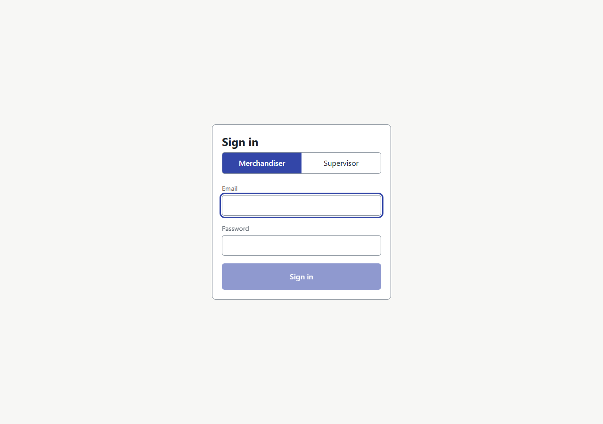

### Sign in: wrong password
A plain message. The password is cleared and the cursor goes back to it. The same message is shown whether the account exists or not.

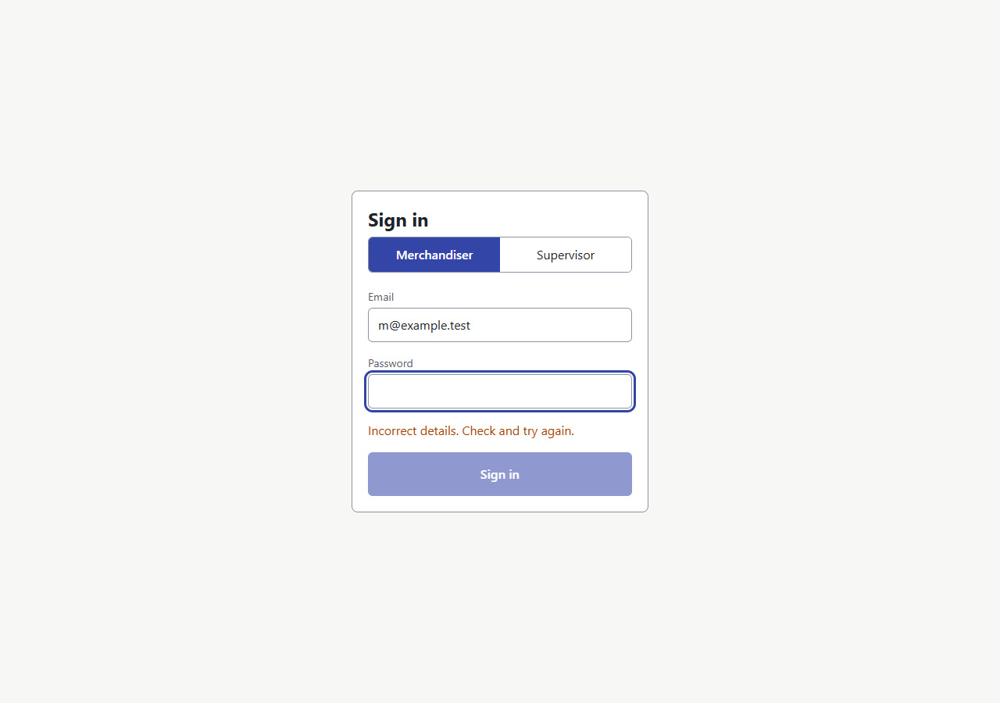

### Order board
Every order, worst first. The counts at the top are filters. Under each order is the working behind its colour. Only the red row is tinted; every status also has an icon and a word.

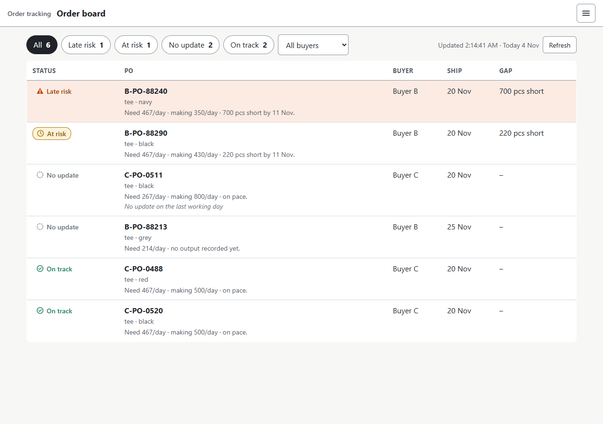

### Order board: filtered to late risk
The filter is kept in the web address, so a reload or a shared link keeps it.

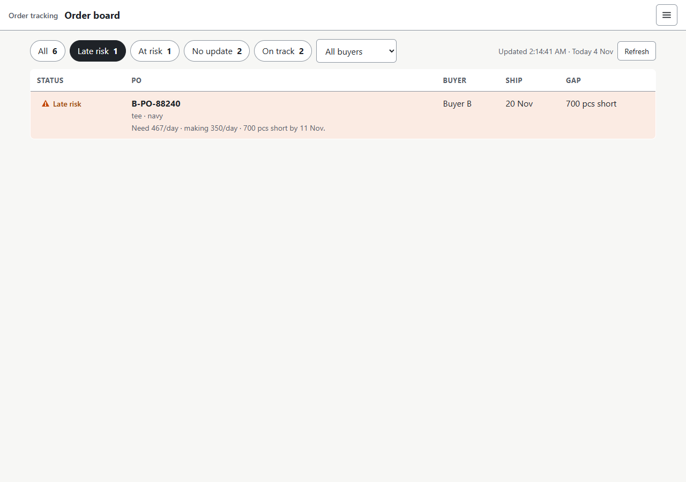

### App menu
Language and sign out live in one menu. Esc closes it and returns focus to the button.

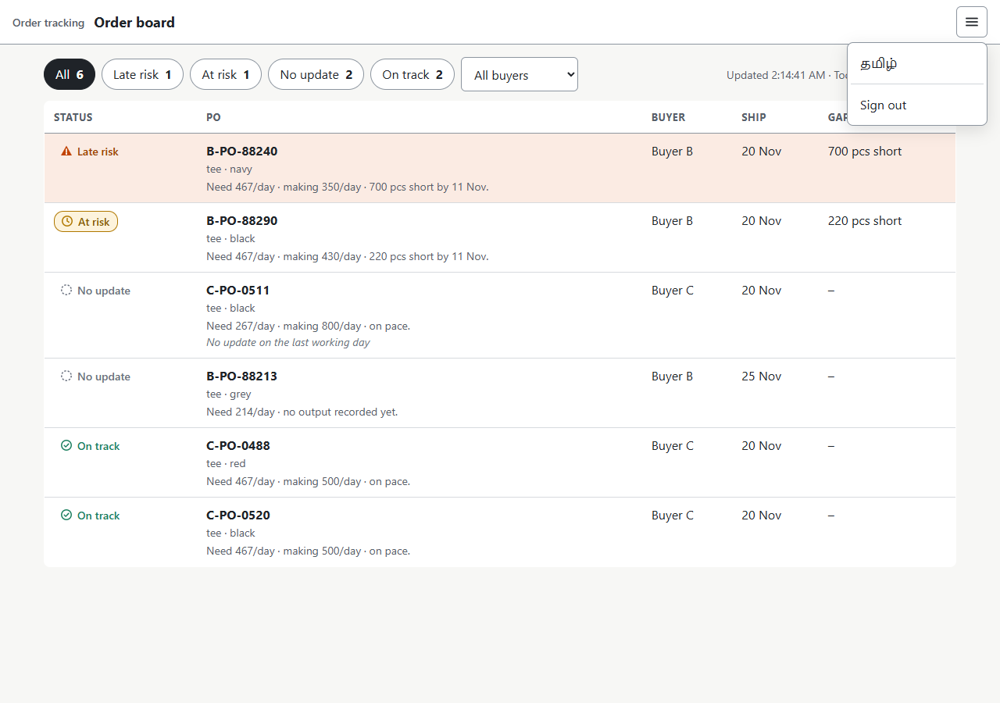

### Order board in greyscale
The check that status never depends on colour alone: the late-risk row still reads from its triangle and its words.

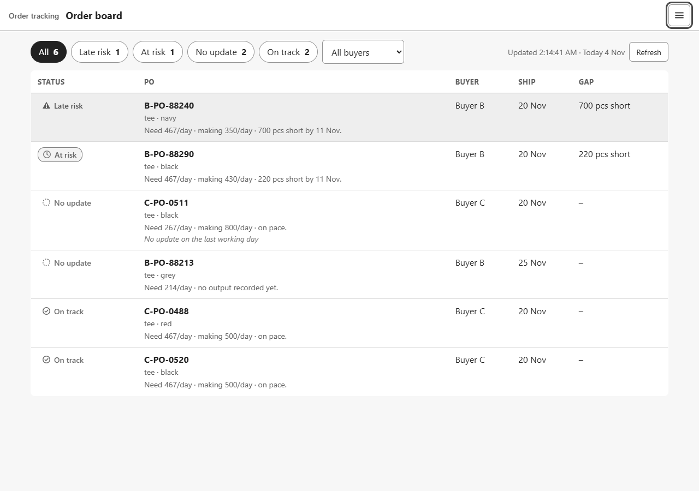

### Order board in Tamil
The four status words in Tamil (taken from the design notes; not yet checked with supervisors). Anything not yet translated stays in English rather than guessing.

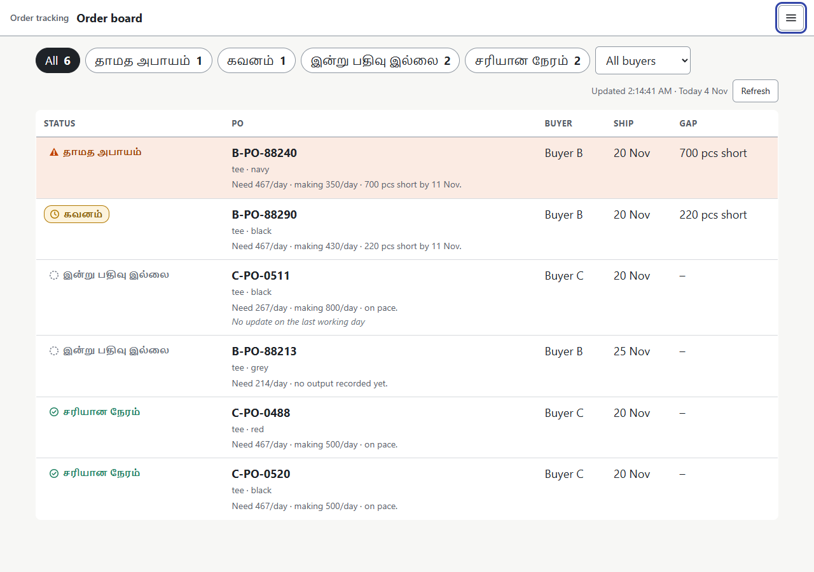

### System status
Public page with no sign-in: plain Up or Down for the API and the database, nothing about how it is built.

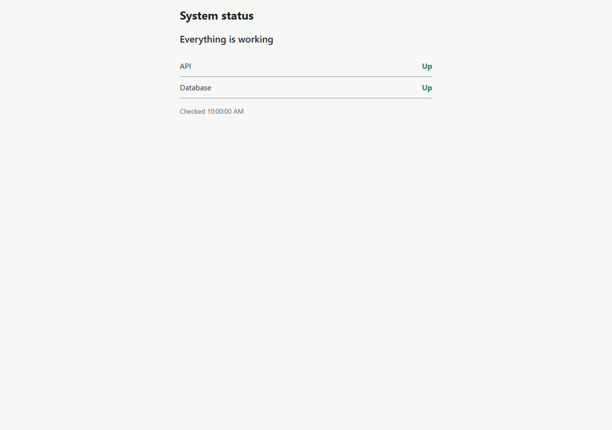

## Phone

### Order board on a phone
Each order becomes a card. The sentence behind the colour stays under the PO number.

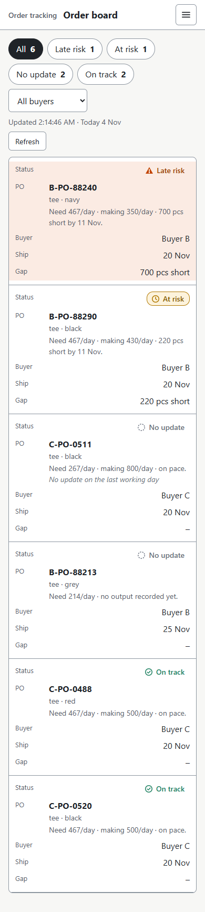

### Supervisor sign-in
Phone number and a 4-digit PIN. The supervisor stays signed in on their own phone.

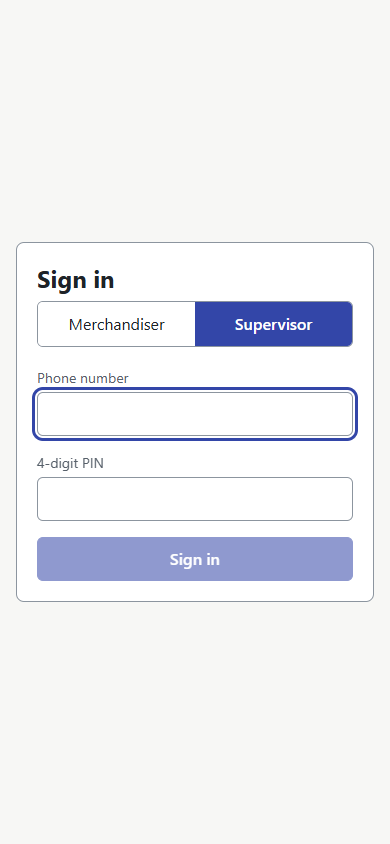

### My orders today
Only this supervisor's own unit. Large buttons, numbers first, soonest due first. The chip at the top says All sent.

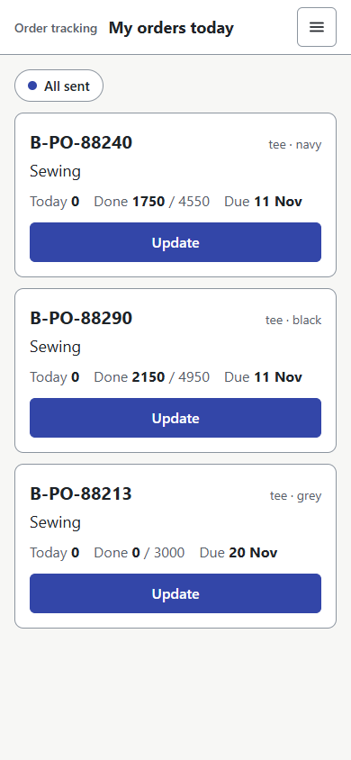

### My orders today in Tamil
Only the title and the sync chip are in Tamil so far; stage names, labels and buttons are still English. Untranslated text is left in English rather than guessed. The Tamil that is here is unreviewed and must be corrected by supervisors, and the rest still has to be written, before the pilot.

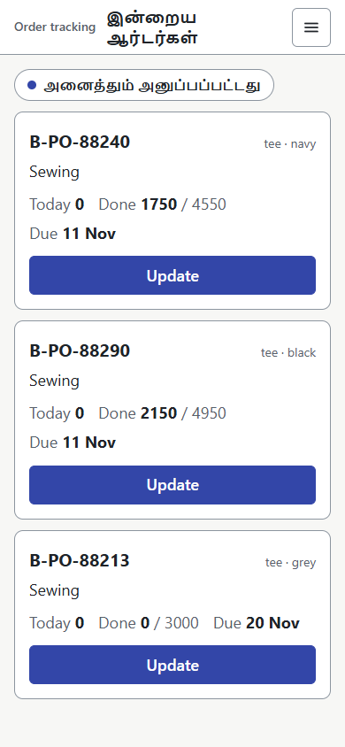

### Daily update
One number, one big button. "Today so far" and "Left" show the effect before anything is sent.

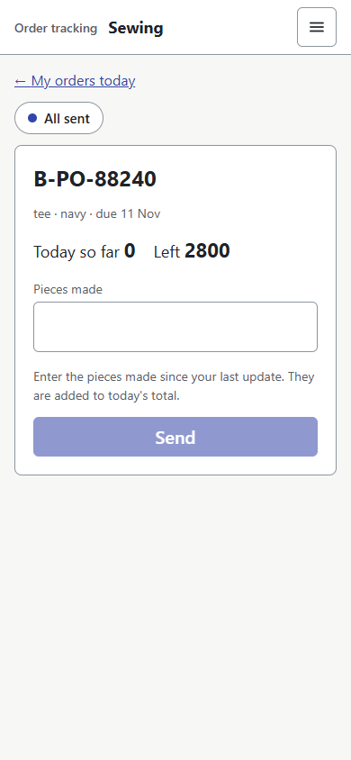

### Daily update: a number larger than what is left
A likely typing slip, so the button changes to "Send 99999 anyway" and asks once. Nothing was sent.

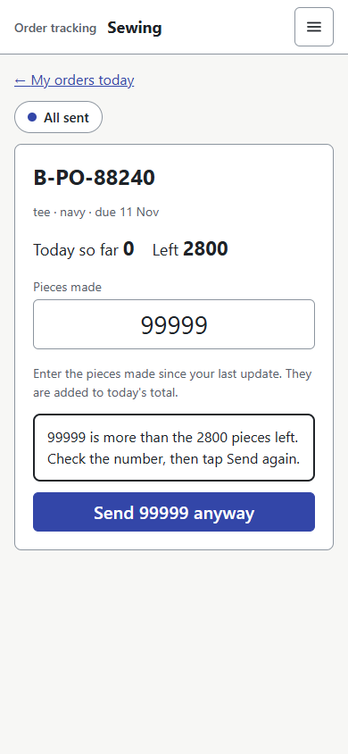

### Daily update with no signal
The number is saved on the phone first. The chip says Offline and how many are waiting. It never says sent until the server has confirmed it.

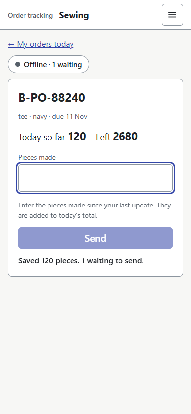

### My orders today with an update waiting
Today so far already includes the waiting 120 pieces, so the supervisor sees the effect straight away.

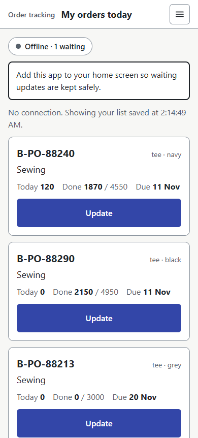

